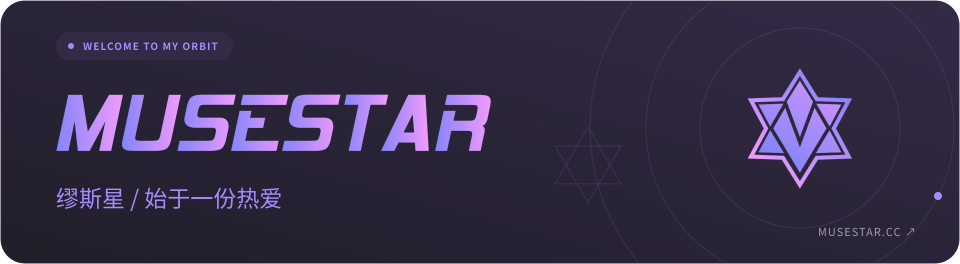
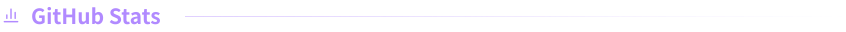
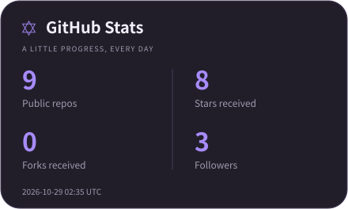
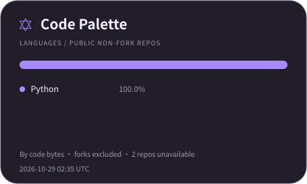
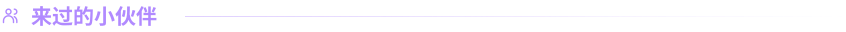

<a href="https://www.musestar.cc/">
  <picture>
    <source media="(prefers-color-scheme: light)" srcset="assets/profile/hero-light.svg">
    
  </picture>
</a>

<h3>
  <picture>
    <source media="(max-width: 600px) and (prefers-color-scheme: light)" srcset="assets/profile/heading-stats-light-mobile.svg">
    <source media="(max-width: 600px)" srcset="assets/profile/heading-stats-dark-mobile.svg">
    <source media="(prefers-color-scheme: light)" srcset="assets/profile/heading-stats-light.svg">
    
  </picture>
</h3>

<a href="https://github.com/MUSESTAR-Official?tab=repositories">
  <picture>
    <source media="(prefers-color-scheme: light)" srcset="assets/profile/stats-light.svg">
    
  </picture>
</a>
<a href="https://github.com/MUSESTAR-Official?tab=repositories">
  <picture>
    <source media="(prefers-color-scheme: light)" srcset="assets/profile/languages-light.svg">
    
  </picture>
</a>

统计来自 GitHub 公开数据，每日更新；语言占比按可访问的非 Fork 仓库代码字节数计算，不代表熟练程度。

  
✧ GitRoll · 开发者档案

   
  <a href="https://gitroll.io/profile/uaDHOPx8hiDV2ccNNQCedGQY2mOF2">
    <picture>
      <source media="(prefers-color-scheme: light)" srcset="https://gitroll.io/api/badges/profiles/v1/uaDHOPx8hiDV2ccNNQCedGQY2mOF2?theme=light">
      
    </picture>
  </a>

<h3>
  <picture>
    <source media="(max-width: 600px) and (prefers-color-scheme: light)" srcset="assets/profile/heading-visitors-light-mobile.svg">
    <source media="(max-width: 600px)" srcset="assets/profile/heading-visitors-dark-mobile.svg">
    <source media="(prefers-color-scheme: light)" srcset="assets/profile/heading-visitors-light.svg">
    
  </picture>
</h3>

  

<picture>
  <source media="(prefers-color-scheme: light)" srcset="assets/profile/footer-light.svg">
  
</picture>
